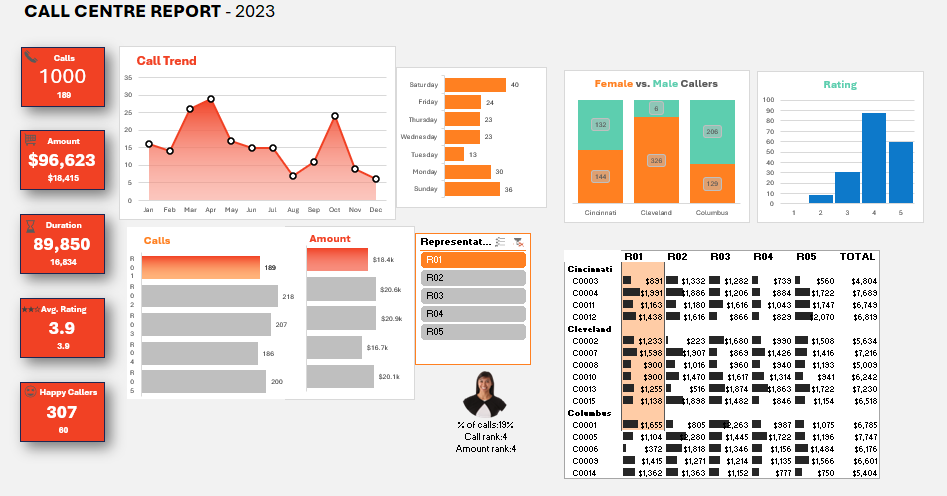
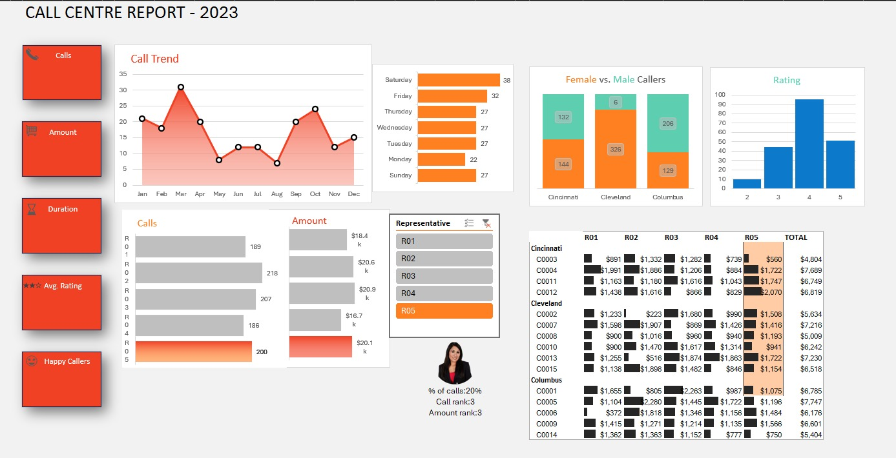

# 📞 Call Center Analytics Dashboard (Excel)

An interactive Excel dashboard that analyses **1,000 customer service calls from 2023** across 5 representatives, 15 customers and 3 cities. Built with Excel Tables, PivotTables, PivotCharts, a slicer and dynamic formulas.



---

## 📌 Table of Contents
- [Business Questions](#-business-questions)
- [Key Metrics](#-key-metrics)
- [Dashboard Features](#-dashboard-features)
- [Screenshots](#-screenshots)
- [Dataset](#-dataset)
- [Project Structure](#-project-structure)
- [How to Use](#-how-to-use)
- [Tools & Skills](#-tools--skills)
- [Key Insights](#-key-insights)
- [Author](#-author)

---

## ❓ Business Questions
1. How many calls were handled, and how did volume change through the year?
2. How do the five representatives compare on calls and purchase amount?
3. Which days of the week are busiest?
4. How satisfied are customers, and how are ratings distributed?
5. How do callers split by gender and city?

## 📊 Key Metrics

| Metric | Value |
|---|---|
| Total calls | **1,000** |
| Total purchase amount | **$96,623** |
| Total call duration | **89,850** |
| Average satisfaction rating | **3.9 / 5** |
| 5★ calls (rating ≥ 4.5) | **307** |

## ✨ Dashboard Features
- **KPI cards** for calls, amount, duration, average rating and happy callers (5★ calls). Each card shows the company total with the selected rep's figure underneath
- **Call trend** by month (area + line chart)
- **Representative slicer**: click R01–R05 and the KPI cards, trend, weekday and rating charts, rep photo and customer matrix all update
- **Rep comparison bars** for calls and amount, with the selected rep highlighted
- **Rep summary** showing % of all calls plus call rank and amount rank
- **Busiest weekday** chart
- **Rating distribution** chart
- **Female vs. male callers** by city
- **Customer × representative matrix** of purchase amount with data bars

## 🖼 Screenshots

### Representative R01 selected


*The big numbers are company totals; the small numbers under them are the selected rep's figures. The rep photo, rank and share of calls change with the slicer.*

### Representative R05 selected


*Same dashboard with R05 selected: the Calls and Amount bars highlight R05, the matrix highlights the R05 column, and the rep summary shows R05's share of calls and ranks.*

## 🗂 Dataset

The workbook has four sheets:

| Sheet | Purpose |
|---|---|
| `Customer Centre Report` | The final dashboard |
| `Pivots` | PivotTables and helper ranges feeding the charts |
| `Data` | Source tables: `calls` (1,000 rows) and `customers` (15 rows) |
| `Assets` | Representative images used by the rep summary |

Calculated columns in `calls`: **FY**, **Day of week**, **Duration Bucket**, **Rating rounded**.
Full column descriptions are in [`docs/data-dictionary.md`](docs/data-dictionary.md).

## 📁 Project Structure

```
call-center-analytics/
├── data/
│   └── Call-Center-Analytics-Dashboard.xlsx
├── images/
│   ├── dashboard-overview.png
│   └── dashboard-rep-r05.png
├── docs/
│   └── data-dictionary.md
├── .gitignore
├── LICENSE
├── README.md
└── UPLOAD-INSTRUCTIONS.md
```

## 🚀 How to Use
1. Download or clone this repository.
2. Open `data/Call-Center-Analytics-Dashboard.xlsx` in **Microsoft Excel 2016 or later** (desktop). The slicer and PivotCharts do not work fully in Excel Online, Google Sheets or LibreOffice.
3. Go to the **Customer Centre Report** sheet.
4. Click a representative in the slicer to filter the dashboard; click again (or use the clear-filter icon) to reset.
5. If values look stale, use **Data → Refresh All**.

```bash
git clone https://github.com/afnannadaf0-eng/call-center-analytics.git
```

## 🛠 Tools & Skills
- Microsoft Excel: Tables, PivotTables, PivotCharts, Slicers
- Formulas: `IF`, `TEXT`, `ROUND`, `RANK`, lookups, structured references
- Dashboard design: KPI cards, conditional highlighting, data bars
- Data modelling across two related tables

## 💡 Key Insights
- **R02** handled the most calls (218); **R04** the fewest (186).
- **R03** generated the highest purchase amount ($20,872), followed closely by **R02** ($20,581) and **R05** ($20,104).
- **March** was the busiest month (155 calls) and **August** the quietest (50).
- **Saturday** had the most calls (161) and **Thursday** the fewest (128).
- Average satisfaction is nearly identical across reps (3.86–3.92), so rating is not what separates their performance.
- **Cleveland** accounts for the most calls (389), and its callers are mostly female (326 of 389).

> Figures are computed from the workbook's 2023 data.

## 👤 Author
**Muhammad Afnan Nadaf**
[LinkedIn](https://www.linkedin.com/in/muhammad-afnan-nadaf-195a24381) · [GitHub](https://github.com/afnannadaf0-eng)

⭐ If you found this useful, consider starring the repo.
